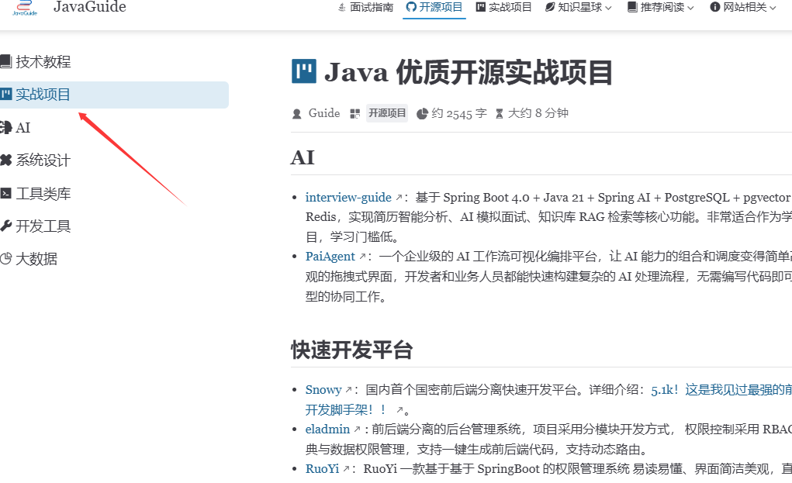
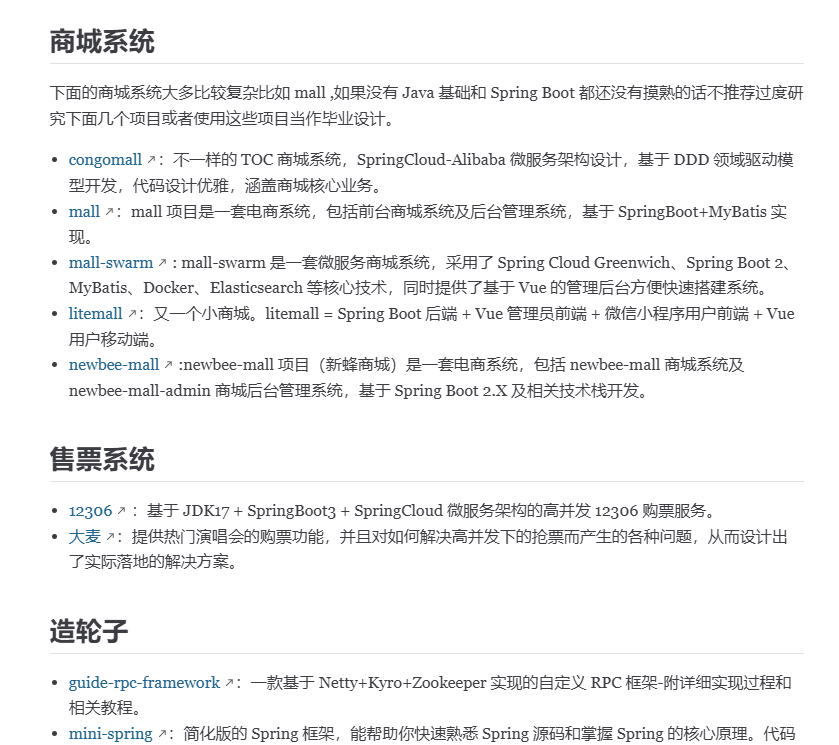
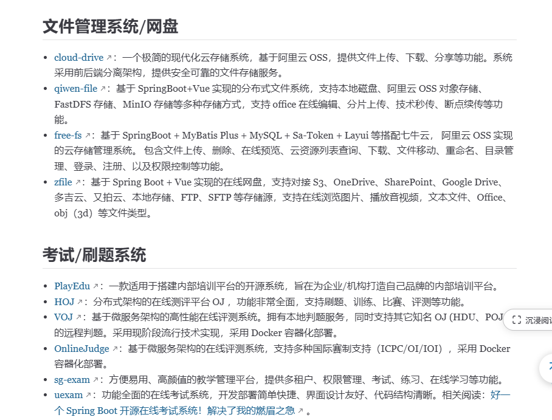
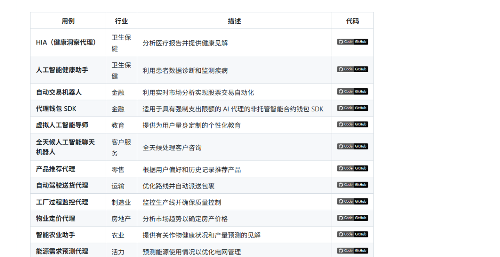
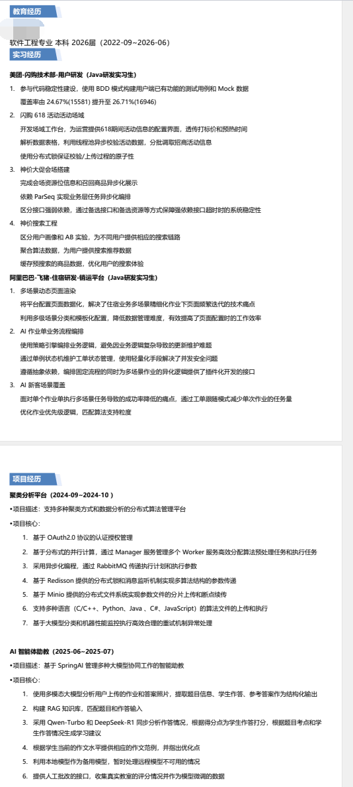
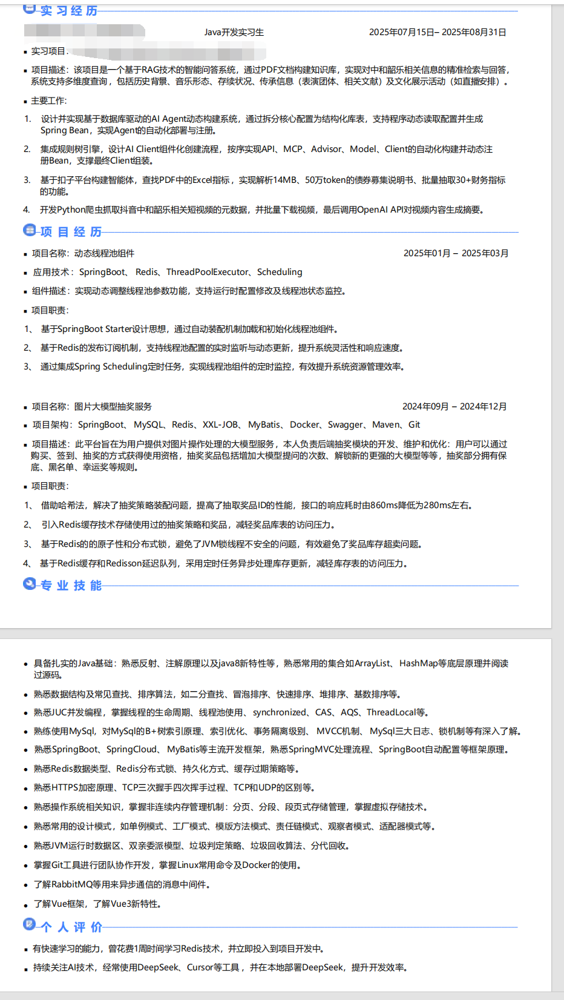
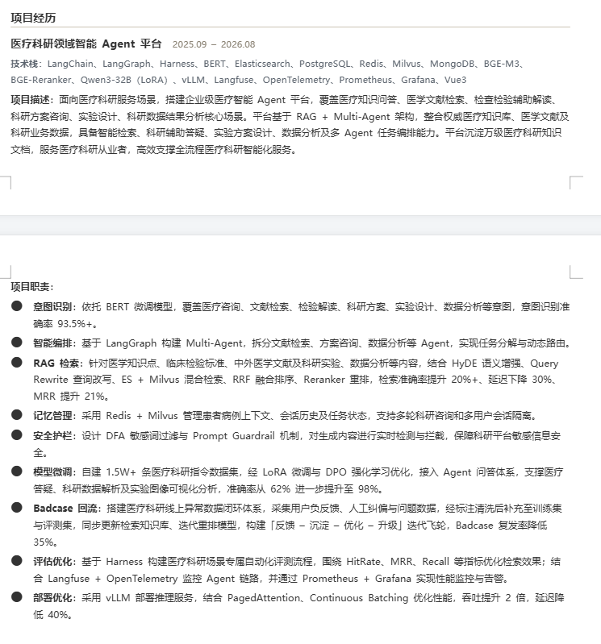

# 行动路线（照着往下走就行）

> 用法：这是一份**执行清单**，不是规划文章。先看「〇、现在在哪一段」，只做当前段的事；每段有**过关验收**，验收过了再进下一段，没过关不往下赶。
> 总目标：**AI 全栈开发**（后端 Python 主线 + Java 二线打底 + 前端联调够用 + 大模型 / RAG / 工具调用）。学长的 Java 13 阶段阶梯只作为后端学习骨架，不单独设 Agent 开发方向。
> 详细规划、JD 对标、红线与项目事实口径见 [PLAN-2027暑假实习.md](./PLAN-2027暑假实习.md)、[ROADMAP.md](./ROADMAP.md)；本文件只回答「现在学什么、做什么、怎么算过关」。
> 时间均为计划准备窗口，不是官方截止日期；竞赛、考研、招聘节点以当年官方通知为准。

---

## 〇、现在在哪一段（2026-11-26）

**当前在阶段 0 · 底座起步。** 不做 AlgoArena 搁置项目的收尾；当前唯一主线：把 Java SE 入门 + Python 基础 + SQL 基础补起来，把电商作业的需求和表结构先梳理出来。

| 顺序 | 时间段 | 段落 | 一句话目标 |
| --- | --- | --- | --- |
| 0 | 2026.11 下旬 – 12 月中 | 底座起步 | Java 语法/OOP 入门、Python 回补、SQL 起步、电商表结构梳理 |
| 1 | 2026.12 下旬 – 2027.01（寒假） | Java SE 核心 + 前端入门 | 集合/OOP 吃透，HTML/CSS/JS 起步，页面能调通接口 |
| 2 | 2027.02 – 03（大二下前段） | 电商后端 + 数据管线 + Boot 入门 | 电商分层 CRUD 跑通，清洗管线成型，学到 Spring Boot + Redis 位置 |
| 3 | 2027.04（大二下后段） | AI Demo + 全栈页面 | 大模型接进业务，工具调用/RAG 最小原型，页面联调跑通 |
| 4 | 2027.05 – 06（大二下末） | 材料 + 投第一段实习 | 简历/自我介绍/台账，分批投递破零 |
| 5 | 2027.07 – 08（大二暑假） | 第一段实习 | 接完整小模块，留交付记录 |
| 6 | 2027.09 – 2028.01（大三上） | 内功 + 后端深化 + 二段投递 | OS/计网补课，SSM/中间件实践，10 月起投第二段实习 |
| 7 | 2028.02 – 06（大三下） | 项目收口 + 再投递 | 1–2 个高质量项目，3–5 月再投，评估就业/考研 |
| 8 | 2028.07 – 08（大三暑假） | 第二段实习 | 沉淀可写进简历的模块与复盘，争取一段中厂 |
| 9 | 2028.09 – 11（大四上） | 秋招 / 转正 | 两段实习 + 项目收口；12 月考研初试为备选 |

---

## 阶段 0 · 底座起步（2026.11 下旬 – 12 月中）

**对应学长阶段**：Java SE 第一阶段（规划科普）+ 第二阶段（Java 入门）。

### 学什么

- **Java**：JDK/IDEA 安装配置；变量常量、数据类型、运算符；分支（if/switch/短路）、循环（while/for/foreach/do-while）；数组（创建使用、冒泡/选择/二分查找理解即可、二维数组）；方法（创建调用、形参实参、递归理解作用）。
- **Python**：函数、异常、模块、虚拟环境回补；能跑通一个最小 FastAPI 接口。
- **SQL**：数据库概念、DDL、DML、DQL 入门；两张表 CRUD、join、执行计划看懂。
- **算法**：长期刷题起步，只保 Easy + 高频 Medium；数组字符串、哈希表优先。

### 做什么

- 电商作业：先写业务实体、表结构、字段类型/约束/主外键、核心流程（下单/库存/校验）设计草稿，不急于写代码。
- Python：跑通一个 health 接口并自测（浏览器 / `/docs` 验证）。

### 课程链接

- Java SE（黑马/韩顺平，二选一，B站高播放量即可）：
  - https://www.bilibili.com/video/BV17F411T7Ao/
  - https://www.bilibili.com/video/BV1yW4y1Y7Ms/
- Python 基础：https://www.bilibili.com/video/BV1sHU9BmEne/
- MySQL：https://www.bilibili.com/video/BV1iq4y1u7vj/

### 过关验收

- 能用 Java 写一个控制台增删改查小项目，把语法/数组/方法用起来。
- SQL 两表 CRUD + join 能现场写出来。
- Python 一个接口可启动、可调用、有自测记录。
- 算法刷完 8–10 题，每题能口述思路与复杂度。

---

## 阶段 1 · Java SE 核心 + 前端入门（2026.12 下旬 – 2027.01，寒假半速）

**对应学长阶段**：Java SE 第三阶段（Java 核心）+ 第五阶段（前端基础）。期末与重修冲刺期主动降速。

### 学什么

- **Java 核心**：面向对象（成员变量/方法、封装继承多态、静态、接口与抽象类、内部类、Lambda）；集合（List/Set/Map、泛型、迭代器、数组/链表/Hash 特性、Stream、Collections/Arrays）；常用类（String/StringBuilder、Math、Optional、LocalDateTime、枚举、日志、异常）；I/O（File、序列化、各种流）；Maven（项目结构、本地仓库与镜像、依赖管理、构建流程、模块管理）；设计理念（开闭/单一职责/依赖倒置、三层架构、MVC）。
- **前端基础**：HTML5 常用标签；CSS3 文本/字体/选择器/布局模型；JavaScript 基本语法、DOM、Ajax 与 JSON；TS 类型标注入门。
- **前端框架**：Vue3 或 React 二选一，学到组件、状态、props、列表渲染、事件。

### 做什么

- **升级版控制台项目**：把阶段 0 的项目从数组改集合、面向过程改面向对象、内存保存改序列化本地保存（如电影选座、商品背包类）。
- 把一个静态表单/列表页改成可交互组件，调通一个后端接口；处理错误/加载态。

### 课程链接

- Java SE（续阶段 0 课程）：https://www.bilibili.com/video/BV17F411T7Ao/
- JavaWeb（熟悉了解为主，不深挖）：https://www.bilibili.com/video/BV1m84y1w7Tb/

### 过关验收

- OOP、集合常用类能口述 + 举自己项目里的例子。
- 独立写出可交互页面并调通后端接口，讲清组件/状态/接口契约概念。
- Java 过 OOP/集合；Maven 能建项目、加依赖、跑构建。

---

## 阶段 2 · 电商后端 + 数据管线 + Spring Boot 入门（2027.02 – 03）

**对应学长阶段**：第四阶段（数据库）→ 第七阶段（SSM 框架）→ 第八阶段（前后端分离 / Spring Boot）→ 第九阶段（中间件入门）。

> **学长过关线**：学到第八阶段 Spring Boot + 第九阶段 Redis 这个位置，就可以开始攒 1–2 个项目；目标中大厂再补第十、十一阶段（见文末后置清单）。

### 学什么

- **MySQL/JDBC**：DQL 多表查询、索引与 explain；JDBC 驱动/PreparedStatement、实体映射、Lombok、事务、DAO 封装；反射、注解、静态/动态代理概念。
- **SSM**：Spring（IoC/DI、XML/注解/Java 配置、AOP/AspectJ）；Spring MVC（控制器、常用注解、拦截器）；MyBatis（增删改查、SSM 整合、动态 SQL、PageHelper）；MyBatis-Plus（分页、逻辑删除、字段填充、条件构造器、Lambda 查询）。
- **Spring Boot**：基本使用、整合 SSM、常用注解、自定义配置、Jar 打包部署、RESTful；JWT 认证授权概念。
- **中间件概念**：Redis 五大数据类型与应用场景、缓存穿透/击穿/雪崩/一致性概念；MQ（Rabbit/Rocket/Kafka 三选一）异步/削峰/解耦概念；MongoDB 概念。
- **Git**：提交、分支、协作流程。

### 做什么

- **电商 Java 项目（主线练手）**：controller → service → dao 三层；商品/分类/订单/用户实体与表结构；列表/详情、下单、库存扣减、订单状态流转；库存不足、重复下单等边界处理与异常。
- **数据清洗管线**：读 CSV/TSV → 缺失/重复/异常/类型/字符串规范化 → ODS/DWD/DWS 分层 → 分组聚合/Top N/占比指标；空数据与类型错误边界单测；README 写复现步骤。

### 课程链接

- SSM + Spring Boot：https://www.bilibili.com/video/BV1AP411s7D7/
- Redis：https://www.bilibili.com/video/BV1cr4y1671t/
- MySQL（续）：https://www.bilibili.com/video/BV1iq4y1u7vj/

### 过关验收

- 数据管线可复现，清洗前后缺失率/重复率可对比，指标能手工抽查。
- 电商一个模块从请求到数据库走通，核心接口有测试/自测记录。
- Java 跑通一组简单 CRUD；Redis/MQ 场景与核心问题能口述。

---

## 阶段 3 · AI Demo + 全栈页面（2027.04）

**对应学长阶段**：Java 框架学完后补充的 AI 应用开发线（Python + FastAPI + 大模型应用）。Agent / 工具调用只是这里的一项技术能力，不是单独投递方向。

### 学什么

- **Python/FastAPI**：接口设计、错误码、日志、配置；结构化返回与异常处理；pytest 覆盖边界。
- **大模型应用**：Prompt 组装；超时、重试、异常兜底、返回解析；token 与成本记录；上下文与流式输出；规则分流（不适合模型的请求走模板）；哈希缓存（同问题 + 同上下文命中复用）。
- **工具调用**：Function Calling 流程（判断是否调工具 → 输出工具名与参数 → 执行 → 回填上下文 → 再判断/给结论）；失败/超预算/超时处理；1–2 个真实工具（查商品/查订单/读文档等）。
- **RAG（可选）**：文档解析 → 分块 → 检索 → 拼进 Prompt；记录召回不准的案例。
- **框架对比（可选）**：LangChain/LangGraph 与原生调用的取舍；学不动退回原生，概念讲清楚即可。MCP 只了解协议概念。

### 做什么

- **AI 全栈 Demo**：场景选商品问答 / 评论分析 / 知识库问答 / 个人工具助手之一；一组接口 + 一条 AI 链路 + 失败案例记录；可选简单对话/表单页面调通后端接口。
- 10–20 条对比用例：普通 prompt / 工具调用版 / RAG 版，记录差异与可复盘结论，不夸大效果。

### 课程链接

- Python 基础：https://www.bilibili.com/video/BV1sHU9BmEne/
- FastAPI 后端：https://www.bilibili.com/video/BV1zV2QBtE39/
- 大模型基础 + Prompt + RAG + Agent + LangChain + LangGraph：https://www.bilibili.com/video/BV178w1z7EHQ/
- MCP 协议：https://www.bilibili.com/video/BV1W7ctzBEi8/
- AI 项目用例参考：https://github.com/ashishpatel26/500-AI-Agents-Projects

### 过关验收

- 现场跑一遍全链路；工具至少两个真实触发；前后端联调跑通。
- 同一问题第二次不产生模型调用；超时仍返回可用结论；能当场报单次 token 与成本。
- 能讲清原生实现 vs 框架的取舍，以及 RAG 召回不准的原因。

---

## 阶段 4 · 材料 + 投第一段实习（2027.05 – 06）

### 做什么

- 60 秒自我介绍 + 3 分钟技术版，写出来、念熟、计时。
- 项目深挖 8 问答案稿（见 [ROADMAP.md](./ROADMAP.md) 第十一节）+ 角色说明。
- 简历按事实对齐；带【目标】【待填】的条目做完前不删标记；未落地技术栈只标学习中/规划中。
- 投递台账跑起来：公司/岗位/渠道/投递日/状态/面试时间/面试问了什么/复盘一句话。
- 分批投递 AI 全栈 / 全栈 / 后端岗，破零优先。

### 投递渠道

BOSS 直聘、拉钩、智联、牛客、实习僧、offer show、大厂官网；校友/学长内推、老师推荐、校内群。

### 投前必做 4 件事

1. 确认岗位还在招；2. 核对学历与届别，要求硕士的岗跳过；3. 核对截止日期；4. 岗位要求的技术简历上能对上，对不上不投。

### 过关验收

- 自我介绍不看稿 55–65 秒讲完；随便抽一个项目问题能讲 2 分钟不卡。

---

## 阶段 5 · 第一段实习（2027.07 – 08，大二暑假）

- 入职接完整小模块，留交付记录、实习评价与可讲的项目细节。
- 复盘暴露的短板，回补到后续项目。
- 能讲清自己负责的部分、用到的技术、遇到的问题与处理方式。

---

## 阶段 6 · 内功 + 后端深化 + 第二段投递（2027.09 – 2028.01，大三上）

### 学什么

- **操作系统**：进程线程、内存管理、文件/磁盘 IO、网络 IO；概念区别 + 举例。
- **计算机网络**：TCP/UDP、握手挥手、HTTP/HTTPS、端口与进程关系。
- **后端深化**：第六阶段原生 Web 补课（Web 底层/HTTP、Tomcat、Servlet、Linux）；SSM/Spring Boot/Redis/MQ 看懂并实践；Linux 目录结构、常用命令、JDK/Tomcat/MySQL 安装、WAR 包部署。
- **面经**：牛客、力扣、CSDN、GitHub、面试鸭；Java 面经 + AI 方向面经。

### 做什么

- 10 月起投第二段实习；持续刷面经与算法题。
- 按课程清单补 OS/计网内功，能口述 + 举例。

### 课程链接

- 操作系统（哈工大 李治军）：https://www.bilibili.com/video/BV19r4y1b7Aw/ ；书《操作系统导论》
- 计算机网络（李全龙 / 湖科大教书匠；《计算机网络：自顶向下方法》）：https://www.icourse163.org/course/HIT-154005
- Linux：https://www.bilibili.com/video/BV1n84y1i7td/
- Java 面经：https://www.xiaolincoding.com/interview/java.html
- AI 方向面经：https://xiaolinnote.com/ai/

### 过关验收

- OS/计网核心概念能口述并举例；第二段实习有实际投递记录与面试复盘。

---

## 阶段 7 · 项目收口 + 再投递（2028.02 – 06，大三下）

### 做什么

- 打磨 1–2 个能讲清实现与原理的项目：开源复现/优化、团队项目、实习延伸均可。
- 3–5 月再投第二段实习；评估主轨（就业）与兜底（考研 / 中小厂 / 国企）。
- 项目渠道：
  - GitHub 检索项目方法：https://www.cnblogs.com/mq0036/p/18047518
  - JavaGuide 实战项目清单：https://javaguide.cn/open-source-project/practical-project.html
  - AI 项目用例：https://github.com/ashishpatel26/500-AI-Agents-Projects
  - 学院工作室/实验室/社团学长学姐带队的团队项目。

### 项目选型倾向

管理系统、博客论坛、网盘、在线评测、AI 应用类优先；尽量避开商城、外卖这类同质化教程项目；讲得清表结构设计、分层取舍、业务边界和"重做会怎么改进"，比功能数量重要。

---

## 阶段 8 · 第二段实习（2028.07 – 08，大三暑假）

- 沉淀可写进简历的模块、数据与复盘；两段实习不全是小公司，争取一段中厂。
- 为秋招攒可讲的项目细节、协作经历与结果数据。

---

## 阶段 9 · 秋招 / 转正（2028.09 – 11，大四上）；考研初试备选（12 月底）

- 两段实习 + 项目 + 笔试面试收口；return 与校招并行。
- **考研备选轨**：计组（哈工大刘宏伟，书《深入理解计算机系统》）、C++ 基本语法（黑马/侯捷二选一）、英语数学不断线；科目以目标院校公告为准。
  - 计组：https://www.bilibili.com/video/BV1t4411e7LH/

---

## 后置清单（毕业画像，实习前不提前深入）

> 以下对应学长第十至十三阶段，单体应用没练熟之前不贸然学；目标中大厂再按顺序补第十、十一阶段。

| 阶段 | 内容 | 处理 |
| --- | --- | --- |
| 第十阶段 Spring Cloud | 注册发现（Nacos/Zookeeper）、服务消费与负载均衡（OpenFeign/Dubbo）、容错（Sentinel）、网关（Gateway）、配置中心、监控追踪（SkyWalking/Arthas） | 冲中大厂时补，现阶段只留概念 |
| 第十一阶段 大型架构 | 分布式锁/事务（2PC/3PC）、分库分表（Sharding-JDBC）、高可用集群、Elastic Stack | 后置，架构师方向再深入 |
| 第十二阶段 容器 | Docker（镜像/容器/Dockerfile/Compose/CI-CD）、Kubernetes | 现阶段了解 Docker 概念；课程见附录 B |
| 第十三阶段 大数据 | 数据采集（Flume/Kafka/Sqoop/Canal）、存储（HDFS/TiDB/HBase）、离线（MapReduce/Hive/Spark）、实时（Storm/Flink） | 后置为毕业画像，不占用实习准备时间 |

## 竞赛线（待核验，不承诺获奖）

- 长期力扣/洛谷刷题，服务笔试机试与考研复试机试。
- 备选：蓝桥杯、PAT 甲级、CCF CSP、百度之星；蓝桥杯对照学长 PDF 目标国奖。报名前核对当年官方通知与校内目录。
- ACM 当前阶段不参与。

---

## 附录 A：学长 Java 13 阶段对照表

> 原表见 [references/Java学习攻略详解.pdf](./references/Java学习攻略详解.pdf)；时长为学长参考值，按自己节奏调整。

| 阶段 | 名称 | 主要内容 | 我们的安排 |
| --- | --- | --- | --- |
| 1 | 规划科普 | 行业趋势、技术栈科普、学习方法、知识体系 | 阶段 0 顺带了解 |
| 2 | Java 入门 | 环境搭建、基础语法、流程控制、数组、方法；控制台小项目 | 阶段 0 |
| 3 | Java 核心 | OOP、集合、常用类、I/O、Maven、设计理念；升级版控制台项目 | 阶段 1 |
| 4 | 数据库 | MySQL、JDBC、反射注解、静态/动态代理；数据库版项目 | 阶段 2 |
| 5 | 前端基础 | HTML5、CSS3、JavaScript；纯前端项目 | 阶段 1 |
| 6 | 原生 Web | Web 底层、网络编程/多线程、Tomcat、Servlet、Linux；原生 Web 项目 | 阶段 6 补课 |
| 7 | SSM 框架 | Spring、Spring MVC、MyBatis、MyBatis-Plus；框架项目 | 阶段 2 / 阶段 6 |
| 8 | 前后端分离 | 前端框架、Spring Boot、SVN/Git、协作工具、Jenkins；前后端分离项目 | 阶段 2（过关线） |
| 9 | 中间件 | Redis、MQ、MongoDB；业务场景实践 | 阶段 2 概念入门，阶段 6 实践 |
| 10 | Spring Cloud | 注册发现、负载均衡、容错、网关、配置中心、监控追踪 | 后置，冲中大厂补 |
| 11 | 大型架构 | 分布式锁/事务、分库分表、高可用、Elastic Stack | 后置 |
| 12 | 容器 | Docker、Kubernetes；容器化与 CI/CD | 后置，Docker 概念先了解 |
| 13 | 大数据 | 数据采集、存储、离线分析、实时计算；大数据项目 | 后置 |

## 附录 B：学长推荐资源链接全表

### Java 后端课程

| 内容 | 链接 |
| --- | --- |
| Java SE（黑马） | https://www.bilibili.com/video/BV17F411T7Ao/ |
| Java SE（韩顺平） | https://www.bilibili.com/video/BV1yW4y1Y7Ms/ |
| MySQL | https://www.bilibili.com/video/BV1iq4y1u7vj/ |
| JavaWeb（熟悉了解为主） | https://www.bilibili.com/video/BV1m84y1w7Tb/ |
| SSM + Spring Boot | https://www.bilibili.com/video/BV1AP411s7D7/ |
| Spring Cloud | https://www.bilibili.com/video/BV1gW421P7RD/ |
| Redis | https://www.bilibili.com/video/BV1cr4y1671t/ |
| Linux | https://www.bilibili.com/video/BV1n84y1i7td/ |

### Python / AI 应用课程

| 内容 | 链接 |
| --- | --- |
| Python 基础 | https://www.bilibili.com/video/BV1sHU9BmEne/ |
| FastAPI 后端开发 | https://www.bilibili.com/video/BV1zV2QBtE39/ |
| 大模型基础 + Prompt + RAG + Agent + LangChain + LangGraph | https://www.bilibili.com/video/BV178w1z7EHQ/ |
| MCP 协议 | https://www.bilibili.com/video/BV1W7ctzBEi8/ |
| Docker | https://www.bilibili.com/video/BV1HP4118797/ ；合集 https://www.bilibili.com/list/37974444/ |

### 内功课程

| 内容 | 链接 |
| --- | --- |
| 操作系统（哈工大 李治军） | https://www.bilibili.com/video/BV19r4y1b7Aw/ |
| 计算机组成原理（哈工大 刘宏伟） | https://www.bilibili.com/video/BV1t4411e7LH/ |
| 计算机网络（慕课） | https://www.icourse163.org/course/HIT-154005 |

### 项目渠道与面经

| 内容 | 链接 |
| --- | --- |
| GitHub 检索项目方法 | https://www.cnblogs.com/mq0036/p/18047518 |
| JavaGuide 实战项目清单 | https://javaguide.cn/open-source-project/practical-project.html |
| 500 AI Agents Projects 用例 | https://github.com/ashishpatel26/500-AI-Agents-Projects |
| Java 面经（小林 coding） | https://www.xiaolincoding.com/interview/java.html |
| AI 方向面经 | https://xiaolinnote.com/ai/ |

## 附录 C：参考截图

### C1. JavaGuide 项目清单：AI 类项目与快速开发平台

### C2. JavaGuide 商城、售票与造轮子项目

### C3. JavaGuide 网盘类与考试刷题系统

### C4. 500-AI-Agents-Projects 行业用例表

### C5. 参考简历：Java 研发实习 + AI 助教项目

### C6. 参考简历：RAG 知识库与抽奖服务

### C7. 高标参考简历：医疗科研智能 Agent 平台（非现阶段目标，仅作天花板参考）

## 附录 D：存档文件

- 学长原 PDF：[references/Java学习攻略详解.pdf](./references/Java学习攻略详解.pdf)
- 截图目录：[references/images/](./references/images/)
